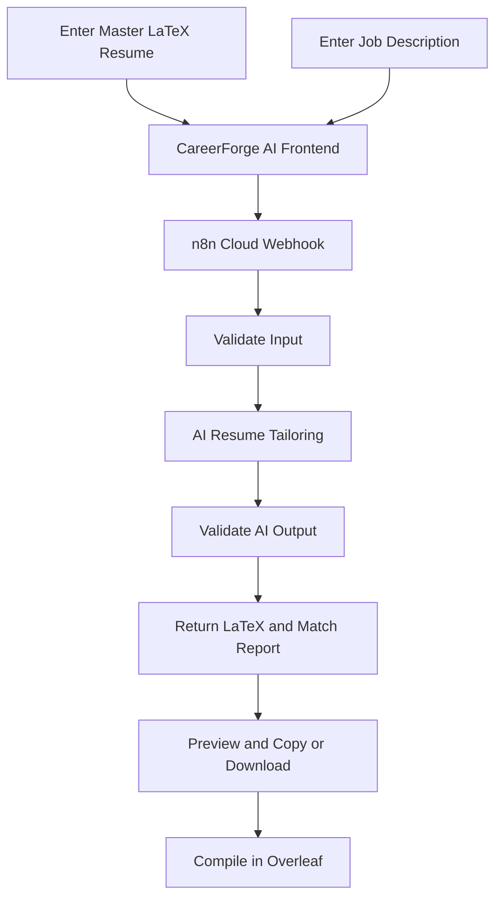

# CareerForge AI — AI-Powered Resume Tailoring

**Tailor your resume to the job. Preserve your experience. Generate LaTeX ready for Overleaf.**

CareerForge AI is an AI-powered web application that helps job seekers tailor their existing LaTeX resumes to specific job descriptions. It connects a React frontend to an n8n Cloud workflow that analyses job requirements, identifies relevant resume evidence, and generates a tailored LaTeX resume with a job-match report.

## 🚀 Live Project Links

### 🌐 CareerForge AI Website

**Open the live application:**  
https://career-forge-ai-seven.vercel.app/

### 🔗 n8n Production Webhook

Copy the following URL and paste it into the **n8n Webhook** field on the website:

```text
https://gladsonissac.app.n8n.cloud/webhook/careerforge-tailor
```

### 🧪 How to Test the Project

1. Open the [CareerForge AI website](https://career-forge-ai-seven.vercel.app/).
2. Copy the n8n Production Webhook URL above.
3. Paste it into the website's webhook configuration field.
4. Click **Test Connection** and confirm the connection succeeds.
5. Upload or paste your master LaTeX resume.
6. Paste the target job description and click **Tailor Resume via n8n**.
7. Review the generated LaTeX resume, job-match score, matched requirements, and missing requirements.
8. Copy or download the generated `.tex` code and compile it using [Overleaf](https://www.overleaf.com/).

**Note:** The webhook is an API endpoint intended to receive POST requests from the application. Opening its URL directly in a browser is not the same as testing the connection.


## 🚀 Features

- **LaTeX Resume Input:** Upload or paste your existing `.tex` resume.
- **Job Description Analysis:** Analyse a target job description to identify relevant skills, qualifications, and responsibilities.
- **AI-Powered Resume Tailoring:** Emphasise relevant experience, skills, and projects supported by the original resume.
- **Job-Match Score:** Get an estimated score indicating how closely your resume aligns with the job requirements.
- **Requirement Analysis:** View matched requirements and missing or unverified skills.
- **LaTeX Code Generation:** Generate a complete LaTeX document that can be copied into Overleaf.
- **Export Options:** Copy the generated code or download it as a `.tex` file.
- **Workflow Automation:** Use n8n Cloud to orchestrate AI processing and response validation.
- **Input and Output Validation:** Check required inputs and basic LaTeX document structure.

## 🛠️ Tech Stack

| Technology | Purpose |
|---|---|
| React | Frontend user interface |
| TypeScript | Application logic and type safety |
| Vite | Development server and build tool |
| Tailwind CSS | Interface styling |
| n8n Cloud | Workflow automation and API integration |
| Google Gemini | AI-powered resume analysis and tailoring |
| LaTeX / Overleaf | Resume source generation and compilation |

## ⚙️ How It Works



1. The user provides an existing LaTeX resume and a job description.
2. The frontend sends the information to the configured n8n webhook.
3. The workflow validates the input and analyses the job requirements.
4. Google Gemini generates a tailored resume and a structured job-match report.
5. The workflow checks the generated output for basic structural issues.
6. The frontend displays the results and provides the LaTeX source for copying or downloading.
7. The user can compile the generated source in Overleaf to obtain the final PDF.

## 💻 Run Locally

### Prerequisites

- [Node.js](https://nodejs.org/)
- npm
- Git
- An n8n Cloud account with the CareerForge AI workflow configured

### 1. Clone the repository

```bash
git clone https://github.com/Gladsn/CareerForge-AI.git
cd CareerForge-AI
```

### 2. Install dependencies

```bash
npm install
```

### 3. Start the development server

```bash
npm run dev
```

Open the local URL shown in the terminal. By default, Vite uses:

```text
http://localhost:5173
```

### 4. Build for production

```bash
npm run build
```

The production files are generated in the `dist/` directory.

## 🔗 Connect to n8n Cloud

CareerForge AI uses an n8n Webhook node to communicate with the AI workflow.

1. Open the CareerForge AI website.
2. Enter the **Production Webhook URL** from your published n8n workflow in the webhook configuration section.
3. Save the configuration.
4. Use **Test Connection** to check connectivity.
5. Enter your master resume and the target job description.
6. Generate the tailored resume and review the returned analysis.

The current webhook endpoint follows this format:

```text
https://YOUR-WORKSPACE.app.n8n.cloud/webhook/careerforge-tailor
```

Replace the example with the Production URL from your own n8n workflow.

### Request Format

The workflow expects a JSON request containing these required fields:

```json
{
  "masterLatex": "Complete original LaTeX resume source",
  "jobDescription": "Full target job description"
}
```

The frontend may also send optional fields such as `targetRole`, `targetCompany`, `masterResumeTex`, and `timestamp`. The current workflow primarily reads `masterLatex` and `jobDescription`.

### Successful Response

The current workflow returns a structured JSON response similar to:

```json
{
  "success": true,
  "latexCode": "Complete tailored LaTeX document",
  "tailoredTex": "Complete tailored LaTeX document",
  "matchScore": 85,
  "matchedRequirements": [
    "Requirements supported by the original resume"
  ],
  "missingRequirements": [
    "Requirements not evidenced in the original resume"
  ],
  "changesMade": [
    "Emphasised relevant project experience"
  ],
  "warnings": []
}
```

The values above are examples only. Actual results depend on the submitted resume, job description, and AI output.

## 🛡️ Responsible AI

CareerForge AI is designed to support accurate and evidence-based resume tailoring.

- The original resume serves as the source of truth for qualifications, skills, and experience.
- Missing or unverified job requirements should be reported rather than fabricated.
- The match score is an estimate of requirement coverage, not a guaranteed ATS score.
- Output validation checks basic LaTeX structure but does not guarantee successful compilation.
- Generated resumes should be reviewed before submission to an employer.

## 🔒 Security Notes

- Keep AI API keys and credentials out of frontend source code.
- Configure the Google Gemini credential securely in n8n.
- The current demonstration webhook does not use authentication. Anyone who obtains its URL may be able to trigger requests and consume AI quota.
- Restrict access and configure appropriate authentication before making the application available to wider audiences.
- Avoid submitting sensitive personal information unless necessary for testing.

## 📁 Project Structure

```text
CareerForge-AI/
├── public/
├── src/
├── index.html
├── package.json
├── package-lock.json
├── tailwind.config.js
├── postcss.config.js
├── tsconfig.json
├── vite.config.ts
├── .gitignore
└── README.md
```

## 🔮 Future Improvements

- Authentication and protected backend integration
- Before-and-after resume comparisons
- More detailed job-requirement evidence mapping
- Stronger LaTeX compilation validation
- Resume analysis history
- Improved error handling and retry logic

**Project Repository:** [CareerForge-AI](https://github.com/Gladsn/CareerForge-AI)
Done by Gladson and Surabhi
---

*CareerForge AI — Better-targeted resumes, backed by your actual experience.*
